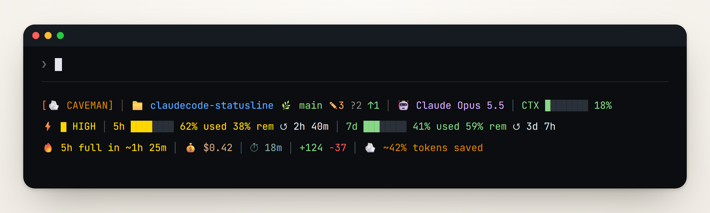
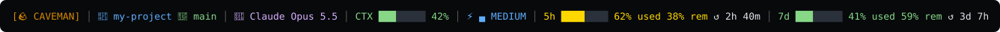
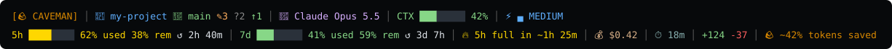
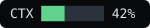
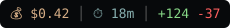
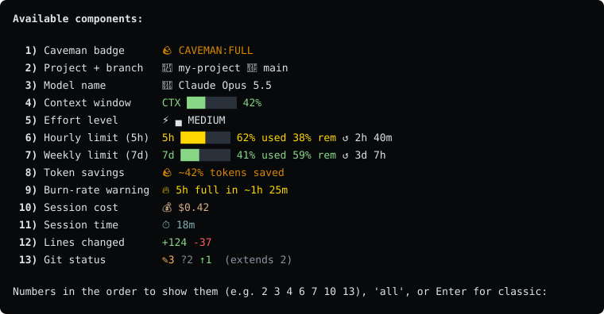
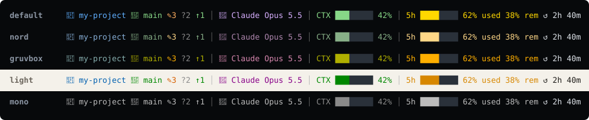

# claudecode-statusline

<p align="center">
  
</p>

A one-command setup for a richly decorated Claude Code statusline with [Caveman mode](https://github.com/JuliusBrussee/caveman) baked in. Interactive installer lets you pick the segments you want, put them in any order and choose a color theme.

> **Already using it?** Jump to [Updating](#updating). v2 is a major release (the bash + `jq` renderer is gone, everything runs on Node), but the installer has an **Update** mode that keeps your current segments, order and theme, so your statusline looks the same afterwards. Breaking changes are in the [changelog](CHANGELOG.md#200---2026-11-22).

## What you get

**The default is a compact line.** A plain install shows the classic set: caveman badge, project and branch, model, context bar, effort, and the 5h / 7d limits.

<p align="center">
  
</p>

**Want everything?** Pick **Install all** in the installer (or set `SL_ORDER=all`). It adds git status next to the branch, the burn-rate warning, session cost, session time, lines changed and the token-savings estimate:

<p align="center">
  
</p>

<sub>Shown on two rows for readability; Claude Code renders it as one line.</sub>

| Segment | Key | In default | Description |
|---|---|:---:|---|
| `🪨 CAVEMAN` | `caveman` | ✅ | Active caveman mode (hidden when off) |
| `📁 project 🌿 branch` | `project` | ✅ | Project folder and current git branch |
| `✎3 ?2 ↑1` after the branch | `git` | extra | Git status: `✎3` changed · `?2` untracked · `↑1` ahead · `↓2` behind · `✖1` conflicts. Detached HEAD shows `@abc1234` |
| `🤖 Claude Opus 5.5` | `model` | ✅ | Current model name |
|  | `ctx` | ✅ | Context window usage bar (green → yellow → red) |
| `⚡ ▄ MEDIUM` | `effort` | ✅ | Effort level with fill icon (only when the model supports it) |
|  | `5h` | ✅ | Hourly rate limit: spent + remaining % + time until reset |
|  | `7d` | ✅ | Weekly rate limit: spent + remaining % + time until reset |
|  | `burn` | extra | **Burn-rate warning.** Appears only when your current pace will exhaust the 5h or 7d limit before it resets, and says when |
|  | `cost` `time` `lines` | extra | Session cost, session duration, lines added / removed |
| `🪨 ~42% tokens saved` | `savings` | ✅ | Live estimate of what Caveman saves (shows once Caveman has stats) |

Segments marked *extra* are new in v2 and off unless you ask for them: choose **Install all**, pick them in **Custom**, or turn single ones on with `SL_COST=1` and friends (see [Customising](#customising-the-statusline)).

Severity colors apply to both values of the rate-limit bars:
- **Used %**: green (low) → yellow (mid) → red (high usage)
- **Rem %**: green (plenty left) → yellow → red (almost none left)

> **About cost.** `💰` shows the session cost Claude Code reports. On a Pro / Max subscription that is the API-equivalent estimate, not what you are billed.

> **How burn rate works.** For each limit window the renderer takes `used% ÷ time elapsed` and projects when it would reach 100%. If that moment is earlier than the reset it shows `🔥 5h full in ~1h 25m` (red when you would run out in under half the remaining time, yellow otherwise). It stays quiet during the first 5% of a window, when there is too little data, and when your pace is safe.

## Prerequisites

| Requirement | Install |
|---|---|
| [Claude Code](https://claude.ai/code) | Download from claude.ai/code |
| [Node.js](https://nodejs.org) 18 or newer (LTS) | `brew install node` / [nodejs.org](https://nodejs.org) |
| `git` (optional) | Shows branch and git status. Windows: [Git for Windows](https://git-scm.com) |

No bash, `jq` or `python3` needed any more.

## Quick start

### macOS / Linux

```bash
git clone https://github.com/FahimFBA/claudecode-statusline.git
cd claudecode-statusline
chmod +x install.sh
./install.sh
```

Then restart Claude Code.

### Windows (PowerShell)

```powershell
git clone https://github.com/FahimFBA/claudecode-statusline.git
cd claudecode-statusline
powershell -ExecutionPolicy Bypass -File install.ps1
```

Then restart Claude Code.

## Updating

Updating is safe to do at any time. The installer tells you what is installed (`Installed: v1.x → this version: v2.0.0`), backs up `settings.json` before touching it, and changes only this project's own entries.

**macOS / Linux**

```bash
cd claudecode-statusline
git pull
./install.sh            # pick "4) Update" (it is the default when an install is found)
# or, no questions asked:
./install.sh --update
```

**Windows (PowerShell)**

```powershell
cd claudecode-statusline
git pull
powershell -ExecutionPolicy Bypass -File install.ps1          # pick "4) Update"
# or, no questions asked:
powershell -ExecutionPolicy Bypass -File install.ps1 -Update
```

Then restart Claude Code. Lost your clone? `git clone` it again; nothing is stored in the clone.

### What Update does and does not do

| | |
|---|---|
| **Keeps** | The `SL_*` settings in your `statusLine` command: which segments are hidden, `SL_ORDER`, `SL_THEME`, `NO_COLOR`. Your other hooks, permissions, model and every other key in `settings.json` |
| **Replaces** | The scripts in `~/.claude/hooks/` (`caveman-*.js`). A leftover v1 `caveman-statusline.sh` is deleted |
| **Rewrites** | Only the `statusLine` command (now `node …`, same `SL_*` prefix) and this project's two hooks, plus the Caveman plugin entries |
| **From 1.x, adds** | Nothing visible. The v2 extras (🔥 burn rate, 💰 cost, ⏱ time, `+/-` lines, ✎ git status) are **off by default**, so the line looks exactly like before. Answer `y` when asked and Update turns them on (`SL_BURN=1 SL_COST=1 SL_TIME=1 SL_LINES=1 SL_GIT=1`), or re-run the installer later and pick **Install all** |
| **Refuses** | To touch a `settings.json` that is not valid JSON. It stops and changes nothing |

Running Update again is a no-op, so it is fine to run after every `git pull`. Check what is installed with:

```bash
node ~/.claude/hooks/caveman-statusline.js --version
```

> **Heads-up for 1.x users:** the 1.x installers replaced your whole `SessionStart` / `UserPromptSubmit` hook lists with their own. If you had your own hooks for those events before installing 1.x, they were overwritten then, and v2 cannot bring them back. v2 only ever replaces its own entries.

### Rolling back

Every install writes two backups next to `settings.json`:

- `settings.json.bak`, the file as it was **before the latest run** (overwritten on each run, so use it right after an update you want to undo)
- `settings.json.pre-v2.bak`, written **once** the first time you upgrade from 1.x and never overwritten

```bash
# undo the last run
cp ~/.claude/settings.json.bak ~/.claude/settings.json
# or return to exactly how it was before v2
cp ~/.claude/settings.json.pre-v2.bak ~/.claude/settings.json
# and put the old scripts back
git checkout v1.0.1 && ./install.sh      # then choose Full / Custom as you did before
```

```powershell
Copy-Item "$env:USERPROFILE\.claude\settings.json.pre-v2.bak" "$env:USERPROFILE\.claude\settings.json" -Force
git checkout v1.0.1; powershell -ExecutionPolicy Bypass -File install.ps1
```

Any [release tag](https://github.com/FahimFBA/claudecode-statusline/tags) can be checked out the same way. Restart Claude Code afterwards.

## Interactive installer

When you run the installer it will ask:

```
How do you want to install?

  1) Default       -- the classic compact line: project, model, context, effort, 5h / 7d limits
  2) Custom        -- choose components and their order
  3) Install all   -- everything: adds burn-rate, cost, time, lines changed and git status
  4) Update        -- keep my current settings, upgrade only (recommended)   <- only shown when an install is found

Choice [default=1]:      (default=4 when an install is found)
```

| Choice | Writes | Result |
|---|---|---|
| **1) Default** | no `SL_*` variables | The compact classic line |
| **3) Install all** | `SL_ORDER=all` | All 12 segments plus git status |
| **2) Custom** | `SL_ORDER=…` | Exactly what you pick, in your order |
| **4) Update** | keeps your current `SL_*` | Same line as before, new scripts |

If you choose **2**, you'll see a numbered menu. Type the numbers in the order you want them shown, `all` for everything, or just press Enter for the classic set:



For example `2 3 4 6 7 10 13` shows project, model, context, 5h, 7d and cost, with git status on. Component **13** (git status) extends component **2**; leave it out to keep just the branch name.

Every mode except Update then asks for a [color theme](#themes), and all of them print a live preview before touching your settings. Your existing `statusLine` in `settings.json` is shown first so you can decide whether to replace it.

## What the installer does

1. Copies hook scripts to `~/.claude/hooks/` (and removes a stale v1 `caveman-statusline.sh`)
2. Merges settings into `~/.claude/settings.json` (backs up the existing file to `settings.json.bak` first, and to `settings.json.pre-v2.bak` once when upgrading from 1.x)
3. Installs the Caveman plugin via `claude plugins install caveman --marketplace caveman`

Existing settings are **merged**, not overwritten: only this project's own hook entries, `statusLine` and plugin entries are touched. Your other hooks, permissions and keys survive, and running the installer again is safe. If `settings.json` is not valid JSON the installer stops and leaves it alone.

## Customising the statusline

Everything is controlled by environment variables in the `statusLine` command (the installer writes them for you). Re-run the installer any time, or edit `~/.claude/settings.json` by hand:

```json
"statusLine": {
  "type": "command",
  "command": "SL_THEME=nord SL_ORDER=project,model,ctx,5h,7d,cost node \"/home/you/.claude/hooks/caveman-statusline.js\""
}
```

| Env var | Default | Effect |
|---|---|---|
| `SL_ORDER=all` | unset | **Everything**: all 12 segments plus git status. What "Install all" writes |
| `SL_ORDER=a,b,c` | unset | Show **only** these segments, in this order. Keys: `caveman project model ctx effort 5h 7d burn cost time lines savings`. Add `git` to also show git status markers. Unknown names are ignored |
| `SL_THEME=name` | `default` | `default` · `nord` · `gruvbox` · `light` · `mono` |
| `NO_COLOR=1` | unset | Disable all colors |
| `SL_BURN=1` `SL_COST=1` `SL_TIME=1` `SL_LINES=1` `SL_GIT=1` | off | Switch one extra **on** without listing everything (ignored when `SL_ORDER` is set) |
| `SL_CAVEMAN=0` | on | Hide caveman badge |
| `SL_PROJECT=0` | on | Hide project + branch (+ git status) |
| `SL_GIT=0` | | Hide git status markers (also skips the slower `git status` call) |
| `SL_MODEL=0` | on | Hide model name |
| `SL_CTX=0` | on | Hide context window bar |
| `SL_EFFORT=0` | on | Hide effort level |
| `SL_5H=0` | on | Hide hourly rate limit |
| `SL_7D=0` | on | Hide weekly rate limit |
| `SL_BURN=0` `SL_COST=0` `SL_TIME=0` `SL_LINES=0` | | Hide an extra even under `SL_ORDER=all` |
| `SL_SAVINGS=0` | on | Hide token savings |

How the pieces combine:

1. **No `SL_ORDER`** → the classic default set; extras only appear if you set their `SL_<X>=1`.
2. **`SL_ORDER=all`** → everything.
3. **`SL_ORDER=a,b,c`** → exactly those, in that order.
4. Then every `SL_<SEGMENT>=0` (and `SL_GIT=0`) removes what it names, whatever came before.

The "Install all" line is long. If it wraps in your terminal, pick fewer segments, for example:

```
SL_ORDER=project,git,model,ctx,5h,burn
```

### Themes



| Theme | For |
|---|---|
| `default` | Dark terminals |
| `nord` | Cool, muted blues and greens |
| `gruvbox` | Warm retro palette |
| `light` | Light terminal backgrounds |
| `mono` | Grays only; relies on bar length instead of color |

All themes use the 256-color palette, so they work in any modern terminal. Set `NO_COLOR=1` for no color at all.

### Preview without Claude Code

```bash
node ~/.claude/hooks/caveman-statusline.js --demo
SL_THEME=gruvbox SL_ORDER=model,ctx,5h,burn node ~/.claude/hooks/caveman-statusline.js --demo
```

From a clone you can also run `npm run demo`.

### Caveman default mode

To change caveman default mode, set the environment variable before starting Claude Code:

```bash
export CAVEMAN_DEFAULT_MODE=lite   # lite | full | ultra | off
```

Or create `~/.config/caveman/config.json`:

```json
{ "defaultMode": "lite" }
```

## Caveman mode commands

| Command | Effect |
|---|---|
| `/caveman` | Activate full mode |
| `/caveman lite` | Lite mode (fewer drops) |
| `/caveman ultra` | Ultra compressed |
| `/caveman off` | Deactivate |
| `stop caveman` | Natural language deactivate |
| `/caveman-stats` | Token usage + savings this session |
| `/caveman-stats --all` | Lifetime stats across all sessions |

### Intensity levels

| Level | Behaviour |
|---|---|
| `lite` | Drop articles and filler, keep sentence structure |
| `full` | Fragments OK, short synonyms, caveman pattern |
| `ultra` | Maximum compression, minimal connectives |

## Files

```
claudecode-statusline/
├── hooks/
│   ├── caveman-activate.js      # SessionStart hook — activates caveman mode
│   ├── caveman-config.js        # Shared config resolver + safe flag I/O
│   ├── caveman-mode-tracker.js  # UserPromptSubmit hook — tracks mode changes
│   ├── caveman-stats.js         # Token usage stats engine
│   ├── caveman-statusline.js    # Statusline renderer (Node, every platform)
│   └── package.json             # CommonJS marker
├── scripts/
│   ├── configure-settings.js    # settings.json install / uninstall / show (used by all installers)
│   └── gen-images.js            # Regenerates the README SVGs from the real theme palette
├── test/                        # node --test suites (renderer + settings merge)
├── .github/workflows/           # CI (tests on 3 OSes x 3 Node versions) and release
├── settings.template.json       # Reference settings (paths replaced by installer)
├── install.sh / install.ps1     # macOS-Linux / Windows installers (also the updaters: --update / -Update)
├── uninstall.sh / uninstall.ps1 # Clean removal
├── CHANGELOG.md
└── README.md
```

## Uninstall

macOS / Linux:

```bash
./uninstall.sh              # asks first
./uninstall.sh --yes        # no prompt
./uninstall.sh --keep-plugin
```

Windows (PowerShell):

```powershell
powershell -ExecutionPolicy Bypass -File uninstall.ps1
powershell -ExecutionPolicy Bypass -File uninstall.ps1 -Yes -KeepPlugin
```

The uninstaller removes `hooks/caveman-*.js` (and a leftover v1 `caveman-statusline.sh`), then removes from `settings.json` **only** the entries this project added: its two hooks, the `statusLine` (if it points at this renderer) and, unless you pass `--keep-plugin`, the `caveman@caveman` plugin and marketplace entries. Everything else is kept and the previous file is saved as `settings.json.bak`. Run it from your clone; to remove the plugin itself afterwards use `claude plugins uninstall caveman`.

## Development

```bash
npm test          # node --test, no dependencies, Node 18+
npm run demo      # render a sample line with your SL_* env vars
node scripts/gen-images.js   # refresh img/*.svg after changing themes or segments
```

CI runs the tests on Linux, macOS and Windows with Node 18, 20 and 22, checks the installer scripts, and performs a real upgrade from the `v1.0.1` tag with `./install.sh --update`. To publish a release, add a `## [x.y.z] - YYYY-MM-DD` section at the top of `CHANGELOG.md` and push to `main`; the release workflow runs the tests, tags `vx.y.z` and creates the GitHub release from that section.

## Credits

- [Caveman plugin](https://github.com/JuliusBrussee/caveman) by JuliusBrussee — the underlying caveman mode engine
- Statusline and installer by [FahimFBA](https://github.com/FahimFBA)
